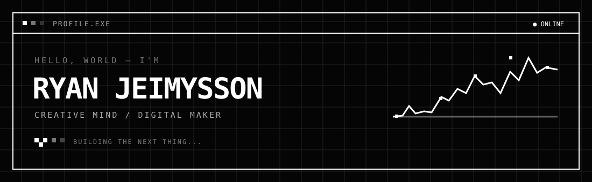
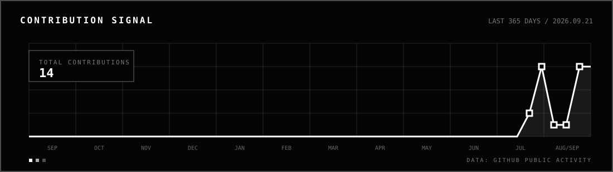
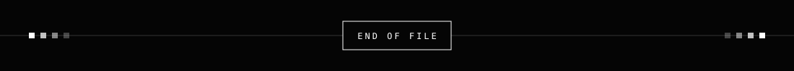

<div align="center">



<br />

`[ PORTFÓLIO EM CONSTRUÇÃO ]` &nbsp; `DESIGN × CÓDIGO × IDEIAS`

</div>

## `01 / sobre`

```txt
olá, eu sou Ryan Jeimysson.

transformo ideias em experiências digitais —
um pixel, uma tela e um experimento por vez.
```

<table>
  <tr>
    <td><b>local</b></td>
    <td>Brasil</td>
    <td><b>status</b></td>
    <td>criando & aprendendo</td>
  </tr>
  <tr>
    <td><b>foco</b></td>
    <td colspan="3">design · tecnologia · experiências digitais</td>
  </tr>
</table>

## `02 / atividade`

<div align="center">



</div>

## `03 / laboratório`

```txt
┌──────────────────────────────────────────────────────────┐
│  [01] interfaces         [02] protótipos                │
│  [03] código criativo    [04] coisas que ainda não têm  │
│                              nome                       │
└──────────────────────────────────────────────────────────┘
```

> este perfil está sempre em movimento. volte depois para encontrar algo novo.

<div align="center">



<sub>© 2026 · feito com curiosidade e café</sub>

</div>
